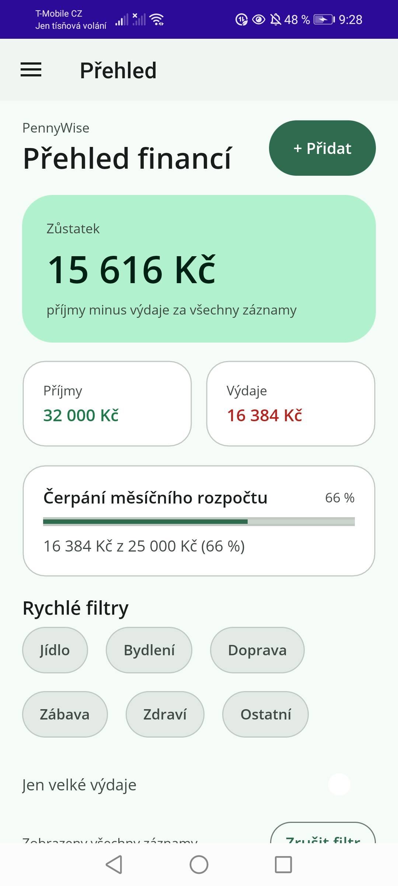
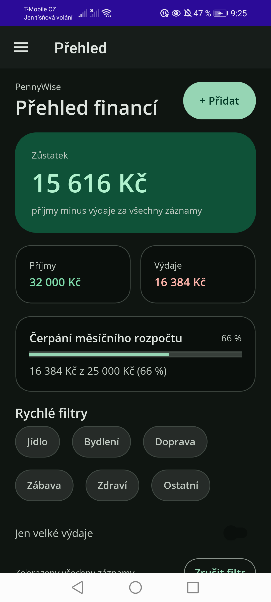
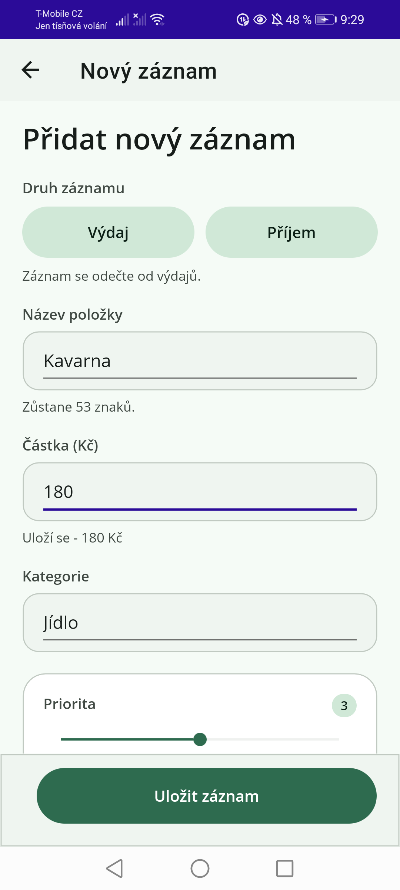
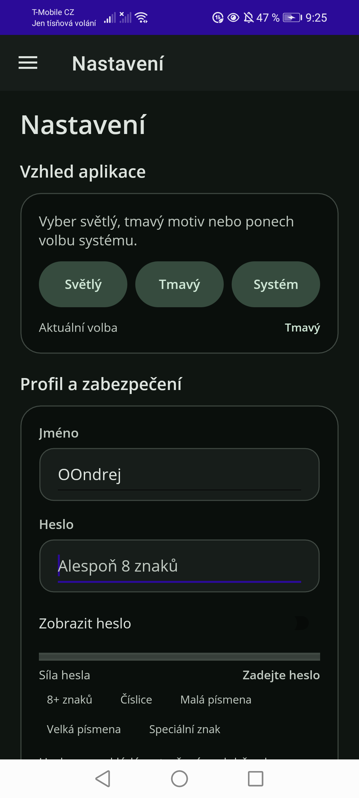
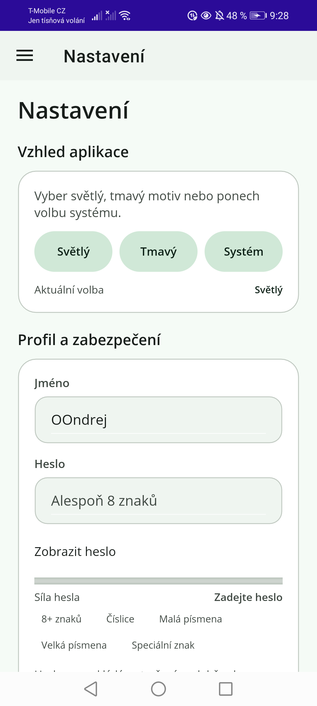
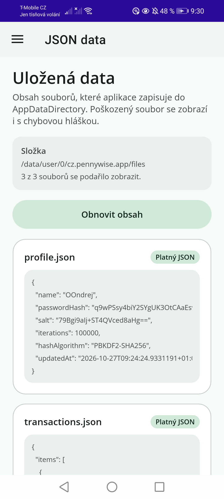
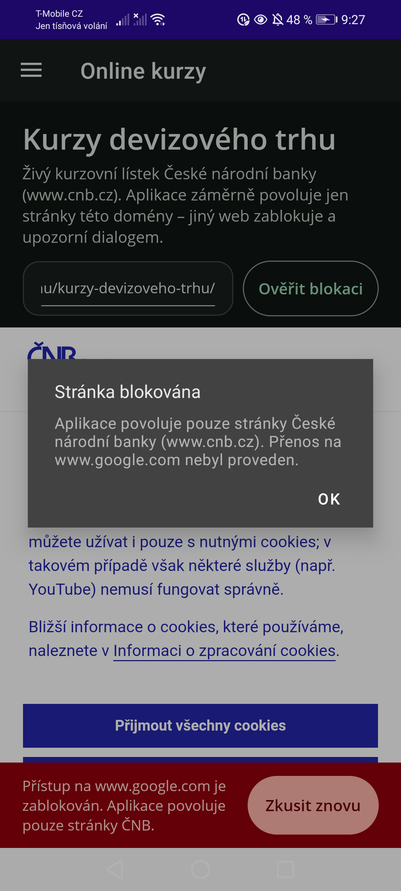

# PennyWise – správa osobních financí

- **Autor:** `[JMÉNO PŘÍJMENÍ]`
- **Třída:** `[TŘÍDA]`
- **Téma:** Správa osobních financí / transakce
- **Platforma:** .NET 9, .NET MAUI, cíl Android (testováno na Androidu 10, arm64;
  `SupportedOSPlatformVersion` je 21, takže jde nainstalovat i na starší zařízení)

## Popis aplikace

PennyWise je ukázková aplikace pro evidenci osobních financí. Ukazuje přehled
zůstatku, měsíčního rozpočtu a posledních transakcí, umožňuje přidávat nové
záznamy přes formulář, zobrazuje živý kurzovní lístek ČNB ve `WebView`, nabízí
nastavení světlého/tmavého motivu a bezpečné uložení profilu do JSON. Poslední
obrazovka zobrazuje obsah všech JSON souborů, které aplikace používá.

### Obrazovky

1. **Přehled** (`Views/DashboardPage.xaml`)
   - karty v `Border` (zůstatek, příjmy, výdaje) v `Grid` s `*` a `Auto`
   - `ProgressBar` s čerpáním měsíčního rozpočtu a textovým vyjádřením
   - rychlé filtry v `FlexLayout` (kategorie) + `Switch` „Jen velké výdaje“
   - seznam 6 výchozích záznamů (`BindableLayout`), tlačítko **+ Přidat**
2. **Nový záznam** (`Views/AddTransactionPage.xaml`, trasa `addtransaction`)
   - není ve flyoutu, otevírá se přes `Shell.Current.GoToAsync(nameof(AddTransactionPage))`
   - `Entry` název, `Entry` částka (`Keyboard="Numeric"`), `Slider` priorita 1–5
     s celočíselným zaokrouhlením, živé popisky, `CheckBox` (pravidelná položka),
     `Switch` (důležité)
   - uložení: tlačítko se okamžitě deaktivuje, `ActivityIndicator` běží cca 2 s,
     potom `DisplayAlert("Úspěch", "Záznam byl uložen", "OK")` a stránka se zavře
   - **možnost selhání**: `Switch` „Simulovat selhání“ (deterministické, pro
     učitele) + 15% náhodná šance. Při selhání zůstane formulář vyplněný a
     stránka se nezavře
   - hardwarové „zpět“ s neuloženými daty se ptá přes `DisplayAlert`
3. **Online kurzy** (`Views/WebPage.xaml`)
   - `WebView` s kurzovním lístkem ČNB, popis stránky, stav načítání
     (`ActivityIndicator`)
   - `Navigating` propustí jen `https` na `cnb.cz` a `*.cnb.cz`; jiný hostitel
     se zruší (`e.Cancel = true`) a uživatel dostane `DisplayAlert`
   - tlačítko **Ověřit blokaci** zkusí otevřít `https://www.google.com/` a
     demonstruje blokaci; při chybě načtení se zobrazí offline hláška + „Zkusit znovu“
4. **Nastavení** (`Views/SettingsPage.xaml`)
   - tři stavy motivu: Světlý / Tmavý / Podle systému (`AppTheme.Unspecified`)
   - jméno, heslo (`Entry IsPassword`), `Switch` „Zobrazit heslo“
   - živý validátor síly hesla: délka ≥ 8 a výskyt číslic, malých/velkých
     písmen a speciálního znaku (5 pravidel, `ProgressBar` + textová úroveň)
   - uložení do `profile.json`, nastavení rozpočtu do `appsettings.json`
5. **JSON data** (`Views/JsonPage.xaml`)
   - formátovaný obsah `profile.json`, `transactions.json`, `appsettings.json`
   - chybějící soubor = „Soubor zatím neexistuje“, poškozený soubor = chybová
     hláška + původní obsah, `RefreshView` i tlačítko pro obnovení

## Snímky obrazovky

| Světlý režim | Tmavý režim |
|---|---|
|  |  |
|  |  |
|  |  |
|  |  |

Další snímky ve `docs/screenshots/`: `rates-light.png`, `json-corrupted.png`
(poškozený JSON), `dashboard-landscape.png` (otočení na šířku).

## Architektura

```
PennyWise/
  Core/          ObservableObject, RelayCommand, AsyncRelayCommand, Result
  Models/        Transaction, UserProfile, AppSettings, TransactionKind, Category
  Services/      JsonStorageService, TransactionService, ProfileService,
                 SettingsService, ThemeService, PasswordHasher, PasswordStrength,
                 WebViewPolicy, CurrencyFormatter
  ViewModels/    BaseViewModel, DashboardViewModel, AddTransactionViewModel,
                 WebViewModel, SettingsViewModel, JsonViewModel, TransactionItem
  Views/         DashboardPage, AddTransactionPage, WebPage, SettingsPage, JsonPage
  Converters/    InverseBooleanConverter
  Resources/     Styles/Colors.xaml, Styles/Styles.xaml,
                 Styles/themes/LightTheme.xaml, Styles/themes/DarkTheme.xaml
```

- **MVVM bez externích balíčků**: `ObservableObject` + `INotifyPropertyChanged`
  ručně, příkazy přes vlastní `ICommand`. Žádný CommunityToolkit, takže školní
  Visual Studio nic nedoplňuje.
- **Navigace**: `AppShell` s flyoutem; jediná dynamická trasa `addtransaction`.
- **DI**: `MauiProgram` registruje služby a stránky, Shell je vytváří z DI.
- **UI logika v code-behind** jen tam, kde to má smysl: zaokrouhlení `Slider`
  (s příznakem proti rekurzi), `ValueChanged`/`TextChanged`/`Toggled`,
  události `WebView`, potvrzení hardwarového „zpět“.

### Ochrana proti dvojkliku

Všechna asynchronní tlačítka (uložit formulář, uložit profil, uložit rozpočet,
obnovit JSON, retry) používají `AsyncRelayCommand`. Ten při běhu nastaví
`_isRunning`, `CanExecute` vrací `false` a tlačítko se automaticky deaktivuje.
Uložení formuláře navíc drží `IsBusy` a zobrazuje `ActivityIndicator`.
`DisplayAlert` je vždy `await`ovaný, aby nevznikly dva dialogy.

## Design systém

- **Material Design 3**: paleta v `Resources/Styles/Colors.xaml` je kompletní
  M3 tonal palette (primary/secondary/tertiary/error + `on-*` + `container`
  varianty, surface úrovně, outline) pro světlý i tmavý režim. Seed barva je
  zelená (finance).
- `themes/LightTheme.xaml` a `themes/DarkTheme.xaml` obsahují jen mapování rolí
  (`Primary`, `OnSurface`, `Outline`, …) na konkrétní tóny. `ThemeService` při
  přepnutí vymění slovník v `Application.Resources.MergedDictionaries`, takže
  se všechny `{DynamicResource …}` ve stylech přepočítají okamžitě – bez restartu.
- **`AppTheme.Unspecified`** pro „Podle systému“: aplikace poslouchá
  `RequestedThemeChanged` a při změně systémového motivu si sama přepne paletu.
- `Styles.xaml` obsahuje implicitní styly (Label, Entry, Button, Switch,
  CheckBox, Slider, ProgressBar, Border, …) a pojmenované styly: `CardBorder`,
  `HeroCardBorder`, `PrimaryButton`, `WarningButton`, `SecondaryButton`,
  `OutlinedButton`, `FilterChip`/`FilterChipSelected`, `BadgeBorder`,
  `SectionTitle`, `CaptionLabel`, `AmountPositive`/`AmountNegative`, `ErrorLabel`.
- Zakulacené rohy přes `Border` + `StrokeShape="RoundRectangle …"`, žádný `Frame`.
- Ikony/obrázky: vlastní SVG ikona aplikace a splash (`Resources/AppIcon`,
  `Resources/Splash`) a kruhové „iniciálové“ odznaky v seznamu transakcí.

## Ukládání dat (JSON)

Soubory jsou v `FileSystem.AppDataDirectory` (`/data/user/0/cz.pennywise.app/files`).

**`profile.json`** – heslo se **nikdy neukládá v otevřené podobě**:

```json
{
  "name": "Jan Novák",
  "passwordHash": "q9wPSsy4biY2SYgUK3OtCAaEsvHhyQLwlFNJi4aj/Ks=",
  "salt": "79Bgi9aIj+ST4QVced8aHg==",
  "iterations": 100000,
  "hashAlgorithm": "PBKDF2-SHA256",
  "updatedAt": "2026-10-27T09:24:24.9331191+01:00"
}
```

Zadání neurčuje algoritmus. Zvolil jsem **PBKDF2-HMAC-SHA256** s náhodnou
16bajtovou solí a 100 000 iteracemi, protože je součástí .NET (`Rfc2898DeriveBytes`)
a nevyžaduje žádný NuGet balíček. Ověření používá `CryptographicOperations.FixedTimeEquals`.

**`transactions.json`** – pole záznamů (`items`), při prvním spuštění se
naplní 6 ukázkovými transakcemi; **`appsettings.json`** – měsíční rozpočet a
zvolený motiv.

`JsonStorageService` zapisuje nejdřív do `.tmp` souboru a pak přejmenuje, takže
přerušený zápis nezanechá rozbitý JSON. Chybějící soubor, prázdný soubor a
`JsonException` jsou ošetřené (`LoadResult.State = Missing / Corrupted`), obrazovka
JSON pak ukáže chybovou hlášku místo pádu.

## Simulace selhání odeslání

Ve formuláři je `Switch` **Simulovat selhání**: se zapnutým přepínačem každé
uložení selže. K tomu je 15% náhodná šance, aby se chybová cesta objevila i bez
přepínače. Deterministický přepínač je důležitý proto, že testování musí být
reprodukovatelné – náhoda sama o sobě by se u učitele nemusela trefit.

## Build a spuštění

### Windows (Visual Studio 2022)

1. Otevřít `PennyWise/PennyWise.csproj` (nebo `PennyWise.sln`).
2. Visual Studio nabídne instalaci workloadu **.NET MAUI** a Android SDK – potvrdit.
3. Cíl `net9.0-android` (nebo `net9.0-windows…`) a F5.
4. `global.json` žádá .NET SDK 9.0.3xx s `rollForward: latestFeature`.

### NixOS / Linux

Podrobný postup je v [`SETUP-NIXOS.md`](SETUP-NIXOS.md). Stručně:

```bash
cd PennyWise
dotnet build -f net9.0-android -c Debug
dotnet build -f net9.0-android -c Debug -t:Install
```

Release APK pro odevzdání:

```bash
dotnet build -f net9.0-android -c Release -p:AndroidPackageFormat=apk
```

## Testovací scénář

| Krok | Očekávaný výsledek | Stav |
|---|---|---|
| Build `Debug` | 0 chyb, 0 varování | ✅ |
| Instalace a start na zařízení | aplikace běží, `pidof cz.pennywise.app` vrací PID | ✅ |
| Přehled | zůstatek 15 616 Kč, 6 záznamů, progress 66 % | ✅ |
| Filtr kategorie / „Jen velké výdaje“ | seznam se zúží, tlačítko se přebarví | ✅ |
| Formulář: prázdné pole | chybová hláška u pole, uložení neproběhne | ✅ |
| Formulář: úspěch | spinner ~2 s → „Záznam byl uložen“ → zpět, zůstatek 15 616 Kč | ✅ |
| Formulář: simulované selhání | zůstane vyplněný, tlačítko znovu aktivní | ✅ |
| Rychlý dvojklik na Uložit | uloží se jen jednou | ✅ |
| Slider | hodnota se vždy celá (1–5), popisek se mění živě | ✅ |
| WebView ČNB | kurzovní lístek se načte | ✅ |
| WebView cizí doména | `DisplayAlert` „Stránka blokována“, zůstane na ČNB | ✅ |
| Motiv Světlý / Tmavý / Systém | změna okamžitá, po restartu zůstává | ✅ |
| Validátor hesla | úroveň Slabé/Průměrné/Silné se mění po znacích | ✅ |
| Uložení profilu | `profile.json` s hashem a solí, bez hesla | ✅ |
| Poškozený JSON | obrazovka JSON ohlásí „Soubor je poškozený“ | ✅ |
| Restart aplikace | data zůstávají z `transactions.json` | ✅ |
| Otočení na šířku | layout se přizpůsobí, nic se neztratí | ✅ |

## Odevzdání

Možnost B (GitHub): repozitář obsahuje historii commitů, tento README se jménem,
tématem, popisem a snímky. Do e-mailu učitele:

- **Předmět:** `PRG4 - MAUI Projekt - [JMÉNO PŘÍJMENÍ]`
- **Obsah:** odkaz na repozitář + krátké průvodní slovo

Záložní ZIP (bez `bin/obj`): `git archive --prefix=PennyWise/ HEAD -o PennyWise.zip`.
